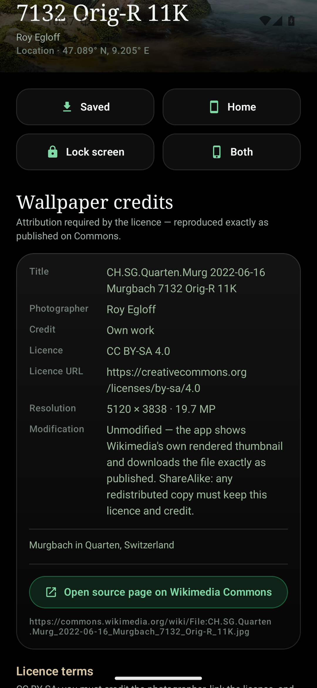
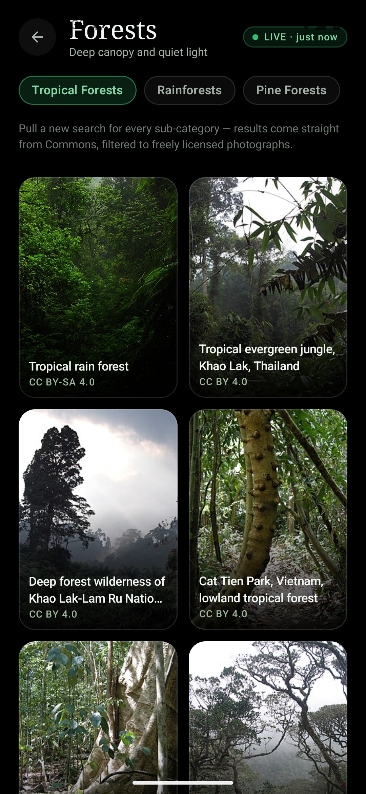
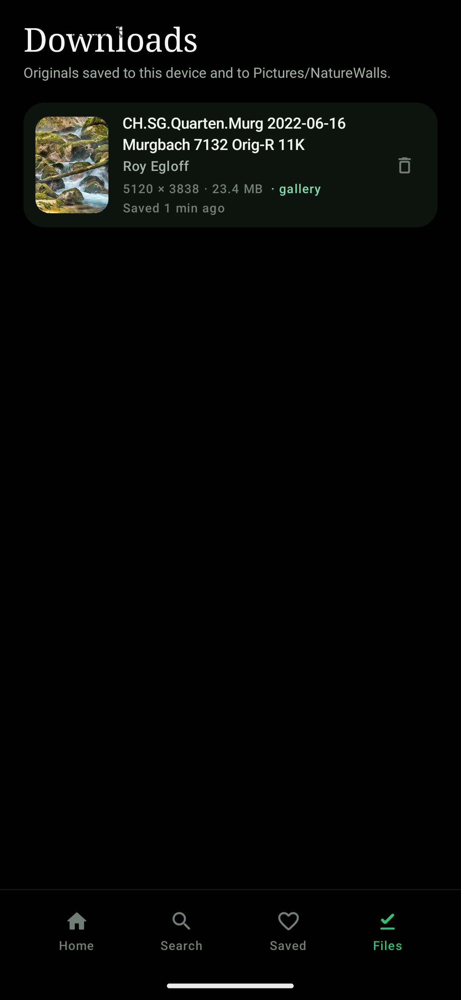

# NatureWalls — Premium Nature & Landscape Wallpapers

## ☕ Donate / Buy me a coffee

**Coming soon** — our donation options are on the way.

| Platform | Status |
| --- | --- |
| Paytm | Coming soon |
| PayPal | Coming soon |
| GPay (Google Pay) | Coming soon |

If you like our work, you can support us with a donation. We are bringing this very soon — **coming soon**.

---

## 🌐 Donate / Buy me a coffee — all languages

**Coming soon** · Paytm · PayPal · GPay — all coming soon.

<details>
<summary><b>🇮🇳 Indian languages</b></summary>

- **Hindi** (हिन्दी): ☕ Donate / Buy me a coffee — जल्द ही आ रहा है। Paytm, PayPal और GPay जल्द ही आ रहे हैं। अगर आपको हमारा काम पसंद है, तो आप डोनेशन देकर हमारा सपोर्ट कर सकते हैं। हम इसे बहुत जल्द ला रहे हैं।
- **Bengali** (বাংলা): ☕ Donate / Buy me a coffee — খুব শিগগিরই আসছে। Paytm, PayPal এবং GPay খুব শিগগিরই আসছে। আমাদের কাজ ভালো লাগলে, আপনি অনুদান দিয়ে আমাদের পাশে দাঁড়াতে পারেন। আমরা খুব তাড়াতাড়ি এটা নিয়ে আসছি।
- **Marathi** (मराठी): ☕ मला कॉफी दान करा / माझ्यासाठी कॉफी विकत घ्या — लवकरच येत आहे. Paytm, PayPal आणि GPay लवकरच येत आहेत. जर तुम्हाला आमचं काम आवडत असेल, तर तुम्ही आम्हाला देणगी देऊन सपोर्ट करू शकता. आम्ही हे लवकरच सुरू करत आहोत.
- **Telugu** (తెలుగు): ☕ నాకు కాఫీ కొనివ్వండి / విరాళం ఇవ్వండి — త్వరలో రాబోతోంది. Paytm, PayPal మరియు GPay త్వరలో రాబోతున్నాయి. మా పని మీకు నచ్చితే, మీరు విరాళం ఇవ్వడం ద్వారా మాకు మద్దతు ఇవ్వవచ్చు. దీన్ని మేము త్వరలోనే తీసుకువస్తున్నాము.
- **Tamil** (தமிழ்): ☕ எனக்கு ஒரு காபி வாங்கிக் கொடுங்கள் / நன்கொடை — விரைவில் வருகிறது. Paytm, PayPal மற்றும் GPay விரைவில் வரவுள்ளன. எங்களுடைய வேலை உங்களுக்குப் பிடித்திருந்தால், நன்கொடை அளித்து நீங்கள் எங்களுக்கு ஆதரவளிக்கலாம். இதை நாங்கள் விரைவில் கொண்டு வருகிறோம்.
- **Gujarati** (ગુજરાતી): ☕ મને કોફી દાન કરો / કોફી ખરીદો — ટૂંક સમયમાં આવી રહ્યું છે. Paytm, PayPal અને GPay ટૂંક સમયમાં આવી રહ્યા છે. જો તમને અમારું કામ ગમે, તો તમે અમને દાન આપીને સપોર્ટ કરી શકો છો. અમે તેને બહુ જલ્દી લાવી રહ્યા છીએ.
- **Kannada** (ಕನ್ನಡ): ☕ ಡೊನೇಟ್ / ನನಗೆ ಒಂದು ಕಾಫಿ ಕೊಡಿಸಿ — ಶೀಘ್ರದಲ್ಲೇ ಬರುತ್ತಿದೆ. Paytm, PayPal ಮತ್ತು GPay ಶೀಘ್ರದಲ್ಲೇ ಬರಲಿವೆ. ನಿಮಗೆ ನಮ್ಮ ಕೆಲಸ ಇಷ್ಟವಾದರೆ, ನೀವು ದೇಣಿಗೆ ನೀಡುವ ಮೂಲಕ ನಮಗೆ ಬೆಂಬಲ ನೀಡಬಹುದು. ನಾವು ಇದನ್ನು ಬಹಳ ಶೀಘ್ರದಲ್ಲೇ ತರುತ್ತಿದ್ದೇವೆ.
- **Malayalam** (മലയാളം): ☕ Donate / Buy me a coffee — ഉടൻ വരുന്നു. Paytm, PayPal, GPay എന്നിവ ഉടൻ വരുന്നു. ഞങ്ങളുടെ വർക്കുകൾ നിങ്ങൾക്ക് ഇഷ്ടമാണെങ്കിൽ, ഒരു സംഭാവന നൽകി ഞങ്ങളെ പിന്തുണയ്ക്കാം. ഞങ്ങൾ ഇത് വളരെ വേഗം കൊണ്ടുവരുന്നുണ്ട്.
- **Odia** (ଓଡ଼ିଆ): ☕ ମୋତେ କଫି କିଣି ଦିଅନ୍ତୁ / ଡୋନେଟ୍ କରନ୍ତୁ — ଖୁବ୍ ଶୀଘ୍ର ଆସୁଛି। Paytm, PayPal ଏବଂ GPay ଖୁବ୍ ଶୀଘ୍ର ଆସୁଛି। ଯଦି ଆପଣଙ୍କୁ ଆମ କାମ ପସନ୍ଦ, ତେବେ ଆପଣ ଆମକୁ ଡୋନେସନ୍ ଦେଇ ସପୋର୍ଟ କରିପାରିବେ। ଆମେ ଏହାକୁ ଖୁବ୍ ଶୀଘ୍ର ଆଣିବୁ।
- **Punjabi** (ਪੰਜਾਬੀ): ☕ ਮੈਨੂੰ ਕੌਫੀ ਦਾਨ ਕਰੋ / ਮੇਰੇ ਲਈ ਕੌਫੀ ਖਰੀਦੋ — ਜਲਦੀ ਆ ਰਿਹਾ ਹੈ। Paytm, PayPal ਅਤੇ GPay ਜਲਦੀ ਆ ਰਹੇ ਹਨ। ਜੇਕਰ ਤੁਹਾਨੂੰ ਸਾਡਾ ਕੰਮ ਪਸੰਦ ਹੈ, ਤਾਂ ਤੁਸੀਂ ਦਾਨ ਦੇ ਕੇ ਸਾਡਾ ਸਾਥ ਦੇ ਸਕਦੇ ਹੋ। ਅਸੀਂ ਇਸਨੂੰ ਬਹੁਤ ਜਲਦੀ ਲੈ ਕੇ ਆ ਰਹੇ ਹਾਂ।
- **Assamese** (অসমীয়া): ☕ Donate / Buy me a coffee — অতি সোনকালেই আহি আছে। Paytm, PayPal আৰু GPay অতি সোনকালেই আহি আছে। যদি আপুনি আমাৰ কাম ভাল পায়, তেন্তে আপুনি দান কৰি আমাক সহায় কৰিব পাৰে। আমি এইটো অতি সোনকালেই লৈ আহি আছোঁ।
- **Urdu** (اردو): ☕ مجھے کافی ڈونیٹ / خریدیں — جلد آرہا ہے۔ Paytm، PayPal اور GPay جلد آرہے ہیں۔ اگر آپ کو ہمارا کام پسند ہے، تو آپ ڈونیشن دے کر ہماری مدد کر سکتے ہیں۔ ہم اسے بہت جلد لا رہے ہیں۔
- **Nepali** (नेपाली): ☕ मलाई कफी किनिदिनुहोस् / दान गर्नुहोस् — छिट्टै आउँदैछ। Paytm, PayPal र GPay पनि छिट्टै आउँदैछन्। यदि तपाईंलाई हाम्रो काम मन पर्छ भने, तपाईंले हामीलाई दान गरेर सहयोग गर्न सक्नुहुन्छ। हामी यो सुविधा धेरै चाँडै ल्याउँदैछौं।
- **Sanskrit** (संस्कृतम्): ☕ मह्यं काफीं क्रीणन्तु / दानं कुर्वन्तु — शीघ्रमेव आगच्छति। Paytm, PayPal तथा GPay अपि शीघ्रमेव आगच्छन्ति। यदि भवन्तः अस्माकं कार्यं रोचन्ते, तर्हि दानं कृत्वा अस्मान् समर्थयितुं शक्नुवन्ति। वयं तत् शीघ्रमेव आनयामः।
- **Konkani** (कोंकणी): ☕ म्हाका कॉफी दान करात / म्हजे खातीर कॉफी घेयात — रोखडेंच येता. Paytm, PayPal आनी GPay रोखडेंच येतले. तुमकां आमचें काम आवडल्यार, तुमी आमकां देणगी दिवन आदार करूंक शकतात. आमी तें खूब बेगीन हाडटात.
- **Maithili** (मैथिली): ☕ हमरा लेल कॉफी डोनेट करू / खरीदू — जल्दिये आबि रहल अछि। Paytm, PayPal आ GPay जल्दिये आबि रहल अछि। जँ अहाँकेँ हमर काज नीक लागैत अछि, तँ अहाँ दान कऽ कऽ हमर समर्थन कऽ सकैत छी। हम एकरा बहुत जल्दी लाबि रहल छी।
- **Kashmiri** (کٲشُر): ☕ مےٚ دِیِو اَکھ کافی — جَلدی یِوان چھُ۔ Paytm, PayPal تہٕ GPay چھِ جَلدی یِوان۔ اَگر تُہؠ سٲنؠ کٲم پَسَند چھِو کَران، تُہؠ ہیٚکِو اَسے اَکھ ڈونیشَن دِتھ سَپورٹ کٔرِتھ۔ اَسؠ چھِ یہِ واریاہ جَلدی اَنان۔
- **Sindhi** (سنڌي): ☕ डोनेट / मूंखे हिक कॉफी वठायो — जल्द अची रह्यो आहे। Paytm, PayPal ऐं GPay जल्द अची रह्या आहिन। जेकडहिं तव्हां खे असां जो कमु वणंदो आहे, त तव्हां असां खे डोनेशन डई सपोर्ट करे सघो था। असीं इहो डाढो जल्द आणी रह्या आहियूं।
- **Dogri** (डोगरी): ☕ डोनेट / मेरे लेई इक कॉफी खरीदो — जल्दी आ करदा ऐ। Paytm, PayPal ते GPay जल्दी आ करदे न। जेकर तुसेंगी साढ़ा कम्म पसंद ऐ, तां तुस साढ़ी मदद दान देइयै करी सकदे ओ। अस इसगी बड़ा जल्दी लेई आ करदे आं।
- **Manipuri** (ꯃꯤꯇꯩ ꯂꯣꯟ): ☕ ꯗꯣꯅꯦꯠ / ꯑꯩꯉꯣꯟꯗꯥ ꯀꯣꯐꯤ ꯑꯃꯥ ꯂꯩꯕꯤꯔꯛꯎ — ꯑꯊꯨꯕꯥ ꯃꯇꯝꯗꯥ ꯂꯥꯛꯀꯅꯤ꯫ Paytm, PayPal ꯑꯃꯁꯨꯡ GPay ꯑꯊꯨꯕꯥ ꯃꯇꯝꯗꯥ ꯂꯥꯛꯀꯅꯤ꯫ ꯀꯔꯤꯒꯨꯝꯕꯥ ꯅꯈꯣꯌꯅꯥ ꯑꯩꯈꯣꯌꯒꯤ ꯊꯕꯛ ꯑꯁꯤ ꯄꯥꯝꯂꯕꯗꯤ, ꯅꯈꯣꯌꯅꯥ ꯗꯣꯅꯦꯁꯟ ꯑꯃꯒꯥ ꯂꯣꯌꯅꯅꯥ ꯑꯩꯈꯣꯌꯕꯨ ꯃꯇꯦꯡ ꯄꯥꯡꯕꯤꯕꯥ ꯌꯥꯏ꯫ ꯑꯩꯈꯣꯌꯅꯥ ꯃꯁꯤ ꯑꯊꯨꯕꯥ ꯃꯇꯝꯗꯥ ꯄꯨꯔꯛꯂꯤ꯫
- **Bodo** (बर’): ☕ आंनो कफि बायना हो — थाबैनो फैगोन। Paytm, PayPal आरो GPay आ थाबैनो फैगोन। जुदि नोंथांमोना जोंनि हाबाखौ मोजां मोनो, नोंथांमोना जोंखौ दान होनानै मदद खालामनो हागोन। जों बेखौ थाबैनो लाबोगोन।
- **Santali** (ᱥᱟᱱᱛᱟᱲᱤ): ☕ ᱫᱟᱱ / ᱤᱧ ᱢᱤᱫ ᱠᱚᱯᱷᱤ ᱠᱤᱨᱤᱧ ᱤᱧ — ᱞᱚᱜᱚᱱ ᱦᱤᱡᱩᱜ ᱠᱟᱱᱟ᱾ Paytm, PayPal ᱟᱨ GPay ᱞᱚᱜᱚᱱ ᱦᱤᱡᱩᱜ ᱠᱟᱱᱟ᱾ ᱡᱩᱫᱤ ᱟᱞᱮᱭᱟᱜ ᱠᱟᱹᱢᱤ ᱯᱮ ᱠᱩᱥᱤᱭᱟᱜ ᱠᱟᱱᱟ, ᱮᱱᱠᱷᱟᱱ ᱫᱟᱱ ᱠᱟᱛᱮ ᱟᱞᱮ ᱜᱚᱲᱚ ᱫᱟᱲᱮᱭᱟᱯᱮᱭᱟ ᱯᱮ᱾ ᱟᱞᱮ ᱱᱚᱶᱟ ᱟᱹᱰᱤ ᱞᱚᱜᱚᱱ ᱞᱮ ᱟᱹᱜᱩᱭᱮᱫᱟ᱾

</details>

<details>
<summary><b>🌍 Global languages</b></summary>

- **Spanish** (Español): ☕ Donar / Invítame un café — Muy pronto. Paytm, PayPal y GPay estarán disponibles muy pronto. Si te gusta nuestro trabajo, puedes apoyarnos con una donación. Lo estamos lanzando muy pronto.
- **French** (Français): ☕ Faire un don / Offrez-moi un café — Bientôt disponible. Paytm, PayPal et GPay arrivent très bientôt. Si vous aimez notre travail, vous pouvez nous soutenir avec un don. Nous le mettons en place très bientôt.
- **German** (Deutsch): ☕ Spenden / Spendier mir einen Kaffee — Bald verfügbar. Paytm, PayPal und GPay kommen sehr bald. Wenn dir unsere Arbeit gefällt, kannst du uns mit einer Spende unterstützen. Wir bringen es sehr bald.
- **Portuguese** (Português): ☕ Doar / Pague-me um café — Em breve. Paytm, PayPal e GPay chegam em breve. Se você gosta do nosso trabalho, pode nos apoiar com uma doação. Estamos trazendo isso muito em breve.
- **Italian** (Italiano): ☕ Dona / Offrimi un caffè — In arrivo. Paytm, PayPal e GPay arrivano presto. Se ti piace il nostro lavoro, puoi sostenerci con una donazione. Lo stiamo lanciando molto presto.
- **Dutch** (Nederlands): ☕ Doneer / Trakteer me op een koffie — Binnenkort beschikbaar. Paytm, PayPal en GPay komen binnenkort. Als je ons werk leuk vindt, kun je ons steunen met een donatie. We brengen dit heel binnenkort.
- **Polish** (Polski): ☕ Przekaż datek / Postaw mi kawę — Wkrótce. Paytm, PayPal i GPay już wkrótce. Jeśli podoba Ci się nasza praca, możesz nas wesprzeć datkiem. Wprowadzamy to bardzo szybko.
- **Russian** (Русский): ☕ Пожертвовать / Купи мне кофе — Скоро. Paytm, PayPal и GPay появятся совсем скоро. Если вам нравится наша работа, вы можете поддержать нас пожертвованием. Мы запускаем это очень скоро.
- **Ukrainian** (Українська): ☕ Пожертвувати / Купи мені каву — Незабаром. Paytm, PayPal і GPay з'являться дуже скоро. Якщо вам подобається наша робота, ви можете підтримати нас пожертвою. Ми запускаємо це дуже скоро.
- **Turkish** (Türkçe): ☕ Bağış yap / Bana bir kahve ısmarla — Çok yakında. Paytm, PayPal ve GPay çok yakında geliyor. İşimizi beğendiyseniz bağışla bizi destekleyebilirsiniz. Çok yakında sunuyoruz.
- **Arabic** (العربية): ☕ تبرّع / اشترِ لي قهوة — قريبًا. Paytm وPayPal وGPay ستتوفر قريبًا جدًا. إذا أعجبك عملنا، يمكنك دعمنا بالتبرع. نطرحه قريبًا جدًا.
- **Persian** (فارسی): ☕ کمک مالی / برایم یک قهوه بخر — به‌زودی. Paytm، PayPal و GPay به‌زودی اضافه می‌شوند. اگر کار ما را دوست دارید، می‌توانید با یک کمک مالی از ما حمایت کنید. این قابلیت را خیلی زود اضافه می‌کنیم.
- **Hebrew** (עברית): ☕ תרומה / קנו לי קפה — בקרוב. Paytm, PayPal ו-GPay יגיעו בקרוב מאוד. אם אתם אוהבים את העבודה שלנו, תוכלו לתמוך בנו בתרומה. אנחנו מביאים את זה בקרוב מאוד.
- **Indonesian** (Bahasa Indonesia): ☕ Donasi / Traktir saya kopi — Segera hadir. Paytm, PayPal, dan GPay segera hadir. Jika Anda menyukai karya kami, Anda dapat mendukung kami dengan donasi. Kami akan menghadirkannya segera.
- **Malay** (Bahasa Melayu): ☕ Derma / Belanja saya kopi — Akan datang. Paytm, PayPal dan GPay akan datang tidak lama lagi. Jika anda suka hasil kerja kami, anda boleh menyokong kami dengan derma. Kami akan membawanya tidak lama lagi.
- **Vietnamese** (Tiếng Việt): ☕ Quyên góp / Mời tôi một ly cà phê — Sắp ra mắt. Paytm, PayPal và GPay sẽ sớm ra mắt. Nếu bạn thích công việc của chúng tôi, bạn có thể ủng hộ bằng một khoản quyên góp. Chúng tôi sẽ sớm mang tính năng này đến.
- **Thai** (ไทย): ☕ บริจาค / เลี้ยงกาแฟฉันสักแก้ว — เร็ว ๆ นี้ Paytm, PayPal และ GPay กำลังจะมาเร็ว ๆ นี้ หากคุณชอบผลงานของเรา คุณสามารถสนับสนุนเราด้วยการบริจาค เรากำลังจะเปิดให้ใช้เร็ว ๆ นี้
- **Japanese** (日本語): ☕ 寄付 / コーヒーをおごる — 近日公開。Paytm、PayPal、GPay も近日対応予定です。私たちの仕事を気に入っていただけたら、寄付で支援できます。まもなく公開します。
- **Korean** (한국어): ☕ 후원 / 커피 한 잔 사주기 — 곧 공개됩니다. Paytm, PayPal, GPay도 곧 지원됩니다. 저희 작업이 마음에 드신다면 후원으로 지원하실 수 있습니다. 곧 선보이겠습니다.
- **Chinese (Simplified)** (简体中文): ☕ 捐赠 / 请我喝杯咖啡 — 即将推出。Paytm、PayPal 和 GPay 即将上线。如果你喜欢我们的作品，可以通过捐赠支持我们。我们很快就会推出。
- **Chinese (Traditional)** (繁體中文): ☕ 捐贈 / 請我喝杯咖啡 — 即將推出。Paytm、PayPal 和 GPay 即將上線。如果你喜歡我們的作品，可以透過捐贈支持我們。我們很快就會推出。
- **Greek** (Ελληνικά): ☕ Δωρεά / Κέρασέ με έναν καφέ — Έρχεται σύντομα. Paytm, PayPal και GPay έρχονται σύντομα. Αν σας αρέσει η δουλειά μας, μπορείτε να μας στηρίξετε με μια δωρεά. Το φέρνουμε πολύ σύντομα.
- **Czech** (Čeština): ☕ Darovat / Kup mi kávu — Již brzy. Paytm, PayPal a GPay budou brzy k dispozici. Pokud se vám naše práce líbí, můžete nás podpořit darem. Přinášíme to velmi brzy.
- **Romanian** (Română): ☕ Donează / Cumpără-mi o cafea — În curând. Paytm, PayPal și GPay vor fi disponibile în curând. Dacă îți place munca noastră, ne poți susține cu o donație. O aducem foarte curând.
- **Hungarian** (Magyar): ☕ Adományozás / Hívj meg egy kávéra — Hamarosan. A Paytm, a PayPal és a GPay hamarosan elérhető. Ha tetszik a munkánk, adománnyal támogathatsz minket. Nagyon hamarosan elhozzuk.
- **Swedish** (Svenska): ☕ Donera / Bjud mig på en kaffe — Kommer snart. Paytm, PayPal och GPay kommer snart. Om du gillar vårt arbete kan du stötta oss med en donation. Vi lanserar det mycket snart.
- **Danish** (Dansk): ☕ Donér / Køb en kaffe til mig — Kommer snart. Paytm, PayPal og GPay kommer snart. Hvis du kan lide vores arbejde, kan du støtte os med en donation. Vi kommer med det meget snart.
- **Norwegian** (Norsk): ☕ Doner / Kjøp en kaffe til meg — Kommer snart. Paytm, PayPal og GPay kommer snart. Hvis du liker arbeidet vårt, kan du støtte oss med en donasjon. Vi lanserer det svært snart.
- **Finnish** (Suomi): ☕ Lahjoita / Tarjoa minulle kahvi — Tulossa pian. Paytm, PayPal ja GPay tulevat pian. Jos pidät työstämme, voit tukea meitä lahjoituksella. Tuomme sen hyvin pian.
- **Swahili** (Kiswahili): ☕ Changia / Ninunulie kahawa — Inakuja hivi karibuni. Paytm, PayPal na GPay zinakuja hivi karibuni. Ikiwa unapenda kazi yetu, unaweza kutusaidia kwa mchango. Tunaileta hivi karibuni.
- **Filipino** (Filipino): ☕ Mag-donate / Bilhan mo ako ng kape — Malapit na. Paparating na ang Paytm, PayPal at GPay. Kung gusto mo ang aming gawa, matutulungan mo kami sa pamamagitan ng donasyon. Ilalabas namin ito sa lalong madaling panahon.

</details>

---

[](https://github.com/technicalnihilist-lgtm/naturewalls/actions/workflows/android.yml)
[](https://github.com/technicalnihilist-lgtm/naturewalls/releases/latest)
-0B3D24)


> **Install:** grab the signed APK from the [latest release](https://github.com/technicalnihilist-lgtm/naturewalls/releases/latest)
> (`NatureWalls-1.0.0.apk`, ~20 MB, Android 8.0+). Screenshots below are real captures from an
> Android 13 emulator, taken by this repo's CI workflow.

A complete Android application (Kotlin · Jetpack Compose · Material 3) that streams real nature
photography from the official **Wikimedia Commons API**, verifies each file's licence and
attribution metadata, and sets any of it as your home screen, lock screen or both.

Everything is **live**. There is no bundled image list, no seed data and no offline catalogue: each
screen issues its own Commons API call when you open it, and every card carries a `LIVE · 2 min ago`
badge with the time of the last successful fetch.

## Screenshots

Real device captures (Pixel 5, Android 13, live content from Wikimedia Commons), refreshed by
`.github/workflows/android.yml` on every push.

| Home — live feed | Collections | Wallpaper detail |
|---|---|---|
|  |  |  |

| Credits on the wallpaper | Search | Category browsing |
|---|---|---|
|  |  |  |

| Favourites | Downloads | Credits ledger |
|---|---|---|
|  |  |  |

---

## 1. What the app does

**Home** — logo, search entry, daily nature wallpaper hero, curated shelf, trending landscapes,
the six collection shelves (Forests, Mountains, Waterfalls & Rivers, Flowers & Plants, Natural
Landscapes, Weather & Seasons), recently added, recently viewed, and a live-source footer.

**Browse** — each collection opens a two-column print-wall grid with its sub-categories as chips
(e.g. Misty Forests, Himalayan Mountains, Cherry Blossoms, Foggy Landscapes). Switching a chip
issues a new Commons search; scrolling to the bottom follows the API `continue` cursor.

**Search** — free-text nature subjects with suggested subjects, recent search history and
paginated results.

**Detail** — full-bleed preview, title, verified location (only when Commons publishes GPS or a
location value, otherwise the natural subject), download, set as home / lock / both, favourite,
share, resolution, photographer, licence name + licence URL, source page link, modification note,
and a plain-language summary of the licence terms.

**Favourites** — saved wallpapers with their credits stored alongside, persisted in Room.

**Downloads** — the original file saved to app storage *and* to `Pictures/NatureWalls`, listed with
size, resolution and save time, deletable.

**Credits** — the complete attribution ledger of every photograph this device has displayed,
each row opening its Wikimedia Commons source page.

---

## 2. Wikimedia integration (real, not mocked)

| Concern | Implementation |
|---|---|
| Endpoint | `https://commons.wikimedia.org/w/api.php` (`data/remote/WikimediaApi.kt`) |
| Discovery | `generator=search` with `gsrsearch="<subject> filetype:bitmap"`, `gsrnamespace=6` |
| Collections | `generator=categorymembers` on `Category:Quality images of nature`, optionally `gcmsort=timestamp&gcmdir=desc` for *Recently added* |
| Metadata | `prop=imageinfo`, `iiprop=url|size|extmetadata|timestamp|mime`, `iiurlwidth=1600` |
| Attribution | `extmetadata`: `Artist`, `Credit`, `LicenseShortName`, `LicenseUrl`, `ImageDescription`, `UsageTerms`, `Categories`, `GPSLatitude/GPSLongitude`, `DateTime` |
| Pagination | the response `continue` map is replayed as query parameters (opaque cursor string) |
| User-Agent | descriptive UA on every request, as Wikimedia's policy requires |
| Resilience | OkHttp retry interceptor (429/5xx, exponential backoff), 48 MB HTTP cache, `maxlag=5`, per-shelf error states with retry |
| Thumbnails | 1600 px preview from the API, 600 px grid thumbnail derived by rewriting the `/NNNpx-` segment — one call, two sizes |

No scraping, no HTML parsing, no bundled fixtures, no fabricated records.

### Licence gate

`data/remote/LicensePolicy.kt` + `WallpaperMapper.kt` admit a file only when **all** of these hold:

* licence is **CC0**, **Public Domain**, **CC BY** or **CC BY-SA**
* licence is not NonCommercial, not NoDerivatives, not "fair use"/"all rights reserved"/unknown
* original is at least **1200 px** wide, and is JPEG or PNG
* when attribution is required (CC BY / CC BY-SA), a creator is actually published
* Commons categories do not mark it as a painting, print, diagram, map, bird, animal portrait,
  building, vehicle, logo or document

Anything that fails is dropped, and the repository keeps requesting the next page until it has
enough survivors to fill the shelf, so a strict filter never leaves a half-empty screen.

---

## 3. Architecture

```
app/src/main/java/com/naturewalls/app/
├─ NatureWallsApp.kt          Application + Coil ImageLoader (25% memory / 256 MB disk cache)
├─ MainActivity.kt            edge-to-edge Compose host
├─ di/AppContainer.kt         manual DI (Retrofit, Room, repositories, utils)
├─ data/
│  ├─ model/                  Wallpaper, DownloadedWallpaper, CategoryCatalog (live search terms)
│  ├─ remote/                 Retrofit API, DTOs (formatversion=2), client, licence policy, mapper
│  ├─ local/                  Room: wallpapers, favorites, downloads, recent_views, search_history, daily_picks
│  ├─ prefs/                  DataStore (last live fetch time, daily pick)
│  └─ repository/             WallpaperRepository (live), LibraryRepository (favourites/downloads)
├─ util/                      ImageDownloader, WallpaperSetter, ShareHelper, HtmlText, TimeFormat
├─ work/DailyWallpaperWorker  WorkManager periodic refresh of the daily pick
└─ ui/
   ├─ theme/                  AMOLED palette, serif+sans typography, shapes
   ├─ components/             GlassPanel, cards, rails, chips, shimmer, state panels
   ├─ home/ browse/ search/ detail/ favorites/ credits/ navigation/
   └─ AppViewModelProvider.kt one factory for all ViewModels
```

* **UI** — Jetpack Compose, Material 3, single-activity Navigation-Compose graph, AMOLED `#000000`
  canvas, forest-green `#2FBF71` accent, glassmorphism panels (white 7% → 2% wash + hairline),
  serif display type, no heavy gradients.
* **Networking** — Retrofit + Gson + OkHttp with retry and caching.
* **Images** — Coil with crossfade, memory/disk caches, thumbnails in grids and 1600 px previews on
  detail.
* **Persistence** — Room for favourites, downloads, recent views, search history, daily pick and
  the metadata cache used by the credits ledger. DataStore for tiny preferences.
* **Wallpaper** — `WallpaperManager.setBitmap(..., FLAG_SYSTEM | FLAG_LOCK)` with
  `isWallpaperSupported` / `isSetWallpaperAllowed` checks and a downsample-to-screen decode, so a
  6000 px original never blows the heap.
* **Downloads** — streamed to disk with progress, published to `MediaStore` (`Pictures/NatureWalls`)
  on Android 10+, legacy path below that.
* **Sharing** — `FileProvider` + `ACTION_SEND`, always with the full attribution block.

### Performance notes
Lazy grids and rails (no nested vertical scrolling), Coil size-aware requests, `inSampleSize`
decoding for wallpaper setting, background IO on `Dispatchers.IO`, in-memory dedupe so the same
image never repeats inside one feed, and a metadata cache pruned to 30 days while favourites and
downloads are kept forever.

---

## 4. Build

Requirements: Android Studio Ladybug+ (or JDK 17 + Android SDK 35), Gradle 8.9 (wrapper pinned).

```bash
# Android Studio: File ▸ Open ▸ <this folder>, then Run.
# Command line:
echo "sdk.dir=/path/to/Android/Sdk" > local.properties
./gradlew assembleDebug      # debug APK (debug key, applicationId com.naturewalls.app.debug)
./gradlew assembleRelease    # R8 + resource shrinking (add your signing config)
```

* `compileSdk 35`, `minSdk 26`, `targetSdk 35`, Kotlin 2.0.21, AGP 8.7.3, Compose BOM 2024.12.01.
* Permissions: `INTERNET`, `ACCESS_NETWORK_STATE`, `SET_WALLPAPER`, and legacy
  `WRITE_EXTERNAL_STORAGE` (maxSdk 28) only.
* Change the contact address in `WikimediaClient.USER_AGENT` to your own before publishing —
  Wikimedia expects a real contact in the User-Agent.

---

## 5. Verification performed

* **Built and shipped by CI** (`.github/workflows/android.yml`): every push produces a signed,
  R8-minified release APK, installs it on an Android 13 emulator, drives the real UI to capture
  nine screenshots, commits them to `docs/screenshots/` and attaches everything to the
  [v1.0.0 release](https://github.com/technicalnihilist-lgtm/naturewalls/releases/latest).
* **Two real bugs were caught by that emulator run and fixed**, which is exactly why it runs:
  * *Blank photographs.* Commons' thumbnail service only renders a fixed set of widths
    (500 / 1280 / 1920 px) and answers **HTTP 400** for anything else. The app was rewriting the
    preview URL to a 600 px thumbnail, so every grid card failed to load. It now takes the API's
    own 500 px thumbnail and derives the 1280 px preview bucket; small originals keep their
    original URL instead of being upscaled.
  * *Blocked image requests.* `upload`/`thumb.wikimedia.org` return **403** to a bare
    `okhttp/x.y.z` User-Agent. Coil now sends NatureWalls' descriptive UA through its call factory.
  * Hardware bitmaps were also disabled (`allowHardware(false)`), because they decode but never
    composite on software-GPU devices and cannot be handed to `WallpaperManager`.
* **Download pipeline proven on-device**: the screenshots show the original *Cabo Greco* file
  (8665 × 4783, 8.2 MB) saved to `Pictures/NatureWalls` and listed with its photographer.
* **Live API contract tested against commons.wikimedia.org**: `formatversion=2` returns
  `query.pages` as an array; `extmetadata` carries `LicenseShortName`, `Artist`, `Categories`,
  `ImageDescription`, `LicenseUrl`; the `continue` block returns `gsroffset` for pagination.
* **Catalogue validated**: all 48 sub-category searches were run against the live API; each
  returned dozens of photographs passing the licence filter (`waterfall` 20/25,
  `sunflower field` 25/25, `himalaya mountains` 23/25). Queries that came back thin were retuned
  before shipping.
* **Filter behaviour measured**: `Quality images of nature` passes 42/50 pages and therefore drives
  the curated shelves; `Featured pictures of nature` passes only 5/15 (it is dominated by bird and
  animal features), so it is deliberately not used.

---

## 6. Attribution policy (short version)

Photographs remain the property of their photographers. NatureWalls redistributes them unmodified
under the licence published on Commons and shows the credit block everywhere: on the detail screen,
in the credits ledger, and inside every share. CC BY-SA copies you pass on must keep the same
licence and credit. Metadata comes from Wikimedia Commons (CC BY-SA 4.0). This app is independent
and not affiliated with the Wikimedia Foundation.
