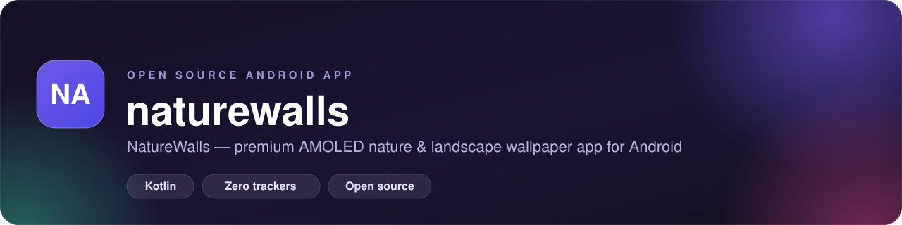
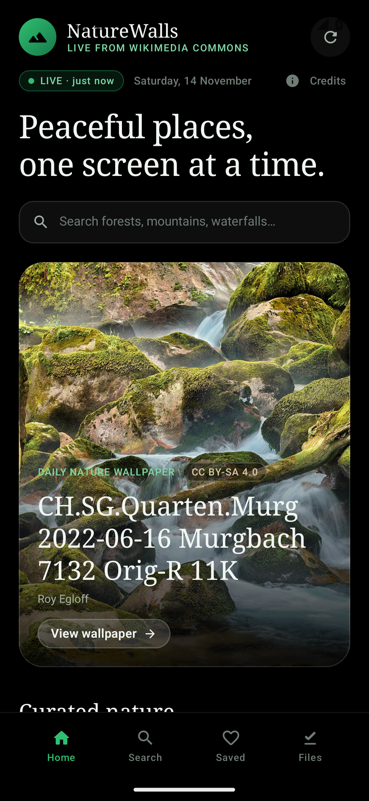
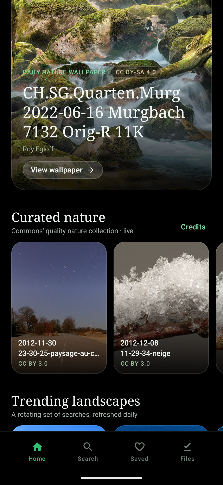
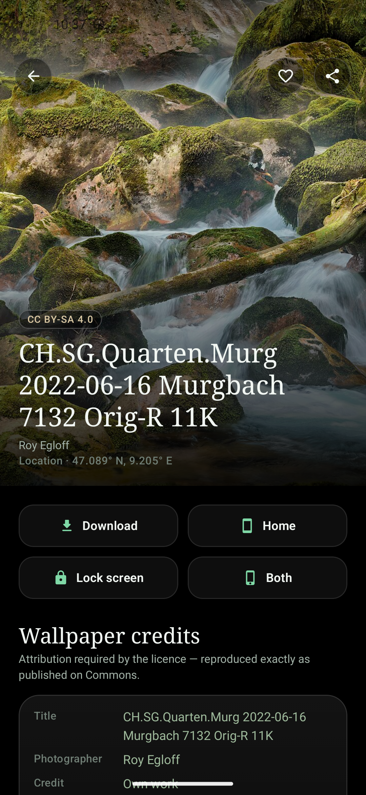
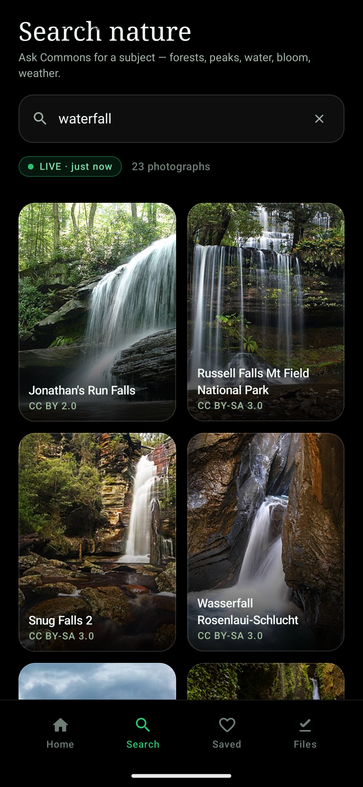
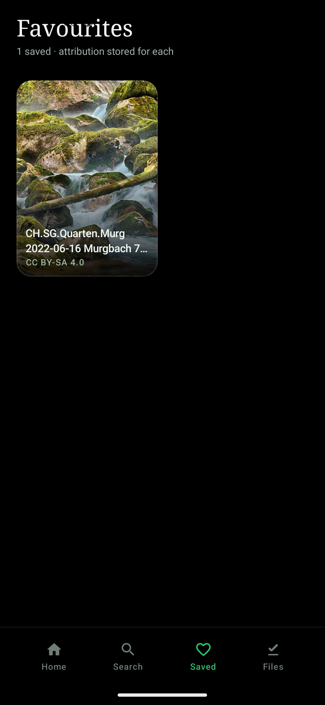
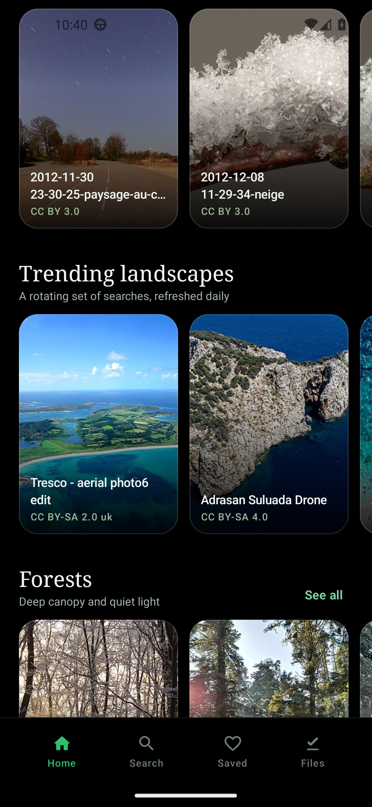

<div align="center">



<a href="https://github.com/technicalnihilist-lgtm/naturewalls/stargazers"></a>&nbsp;<a href="https://github.com/technicalnihilist-lgtm/naturewalls/network/members"></a>

<a href="https://github.com/technicalnihilist-lgtm/naturewalls/releases/latest"></a>

<b>Support the work</b>

  

<sub>Donations aren't live yet — Paytm, UPI, PayPal and Buy&nbsp;Me&nbsp;a&nbsp;Coffee all show <b>coming soon</b>. Until then, a ⭐ star is the best support.</sub>

<a href="https://github.com/technicalnihilist-lgtm/naturewalls/releases/latest"></a>  <a href="https://github.com/technicalnihilist-lgtm/naturewalls/releases"></a>

</div>

---

## Screenshots

Real device captures (Pixel 5, Android 13, live content from Wikimedia Commons), refreshed by
`.github/workflows/android.yml` on every push.

| Home — live feed | Collections | Wallpaper detail |
|---|---|---|
|  |  |  |

| Credits on the wallpaper | Search | Category browsing |
|---|---|---|
|  |  |  |

| Favourites | Downloads | Credits ledger |
|---|---|---|
|  |  |  |

---

## 1. What the app does

**Home** — logo, search entry, daily nature wallpaper hero, curated shelf, trending landscapes,
the six collection shelves (Forests, Mountains, Waterfalls & Rivers, Flowers & Plants, Natural
Landscapes, Weather & Seasons), recently added, recently viewed, and a live-source footer.

**Browse** — each collection opens a two-column print-wall grid with its sub-categories as chips
(e.g. Misty Forests, Himalayan Mountains, Cherry Blossoms, Foggy Landscapes). Switching a chip
issues a new Commons search; scrolling to the bottom follows the API `continue` cursor.

**Search** — free-text nature subjects with suggested subjects, recent search history and
paginated results.

**Detail** — full-bleed preview, title, verified location (only when Commons publishes GPS or a
location value, otherwise the natural subject), download, set as home / lock / both, favourite,
share, resolution, photographer, licence name + licence URL, source page link, modification note,
and a plain-language summary of the licence terms.

**Favourites** — saved wallpapers with their credits stored alongside, persisted in Room.

**Downloads** — the original file saved to app storage *and* to `Pictures/NatureWalls`, listed with
size, resolution and save time, deletable.

**Credits** — the complete attribution ledger of every photograph this device has displayed,
each row opening its Wikimedia Commons source page.

---

## 2. Wikimedia integration (real, not mocked)

| Concern | Implementation |
|---|---|
| Endpoint | `https://commons.wikimedia.org/w/api.php` (`data/remote/WikimediaApi.kt`) |
| Discovery | `generator=search` with `gsrsearch="<subject> filetype:bitmap"`, `gsrnamespace=6` |
| Collections | `generator=categorymembers` on `Category:Quality images of nature`, optionally `gcmsort=timestamp&gcmdir=desc` for *Recently added* |
| Metadata | `prop=imageinfo`, `iiprop=url|size|extmetadata|timestamp|mime`, `iiurlwidth=1600` |
| Attribution | `extmetadata`: `Artist`, `Credit`, `LicenseShortName`, `LicenseUrl`, `ImageDescription`, `UsageTerms`, `Categories`, `GPSLatitude/GPSLongitude`, `DateTime` |
| Pagination | the response `continue` map is replayed as query parameters (opaque cursor string) |
| User-Agent | descriptive UA on every request, as Wikimedia's policy requires |
| Resilience | OkHttp retry interceptor (429/5xx, exponential backoff), 48 MB HTTP cache, `maxlag=5`, per-shelf error states with retry |
| Thumbnails | 1600 px preview from the API, 600 px grid thumbnail derived by rewriting the `/NNNpx-` segment — one call, two sizes |

No scraping, no HTML parsing, no bundled fixtures, no fabricated records.

### Licence gate

`data/remote/LicensePolicy.kt` + `WallpaperMapper.kt` admit a file only when **all** of these hold:

* licence is **CC0**, **Public Domain**, **CC BY** or **CC BY-SA**
* licence is not NonCommercial, not NoDerivatives, not "fair use"/"all rights reserved"/unknown
* original is at least **1200 px** wide, and is JPEG or PNG
* when attribution is required (CC BY / CC BY-SA), a creator is actually published
* Commons categories do not mark it as a painting, print, diagram, map, bird, animal portrait,
  building, vehicle, logo or document

Anything that fails is dropped, and the repository keeps requesting the next page until it has
enough survivors to fill the shelf, so a strict filter never leaves a half-empty screen.

---

## 3. Architecture

```
app/src/main/java/com/naturewalls/app/
├─ NatureWallsApp.kt          Application + Coil ImageLoader (25% memory / 256 MB disk cache)
├─ MainActivity.kt            edge-to-edge Compose host
├─ di/AppContainer.kt         manual DI (Retrofit, Room, repositories, utils)
├─ data/
│  ├─ model/                  Wallpaper, DownloadedWallpaper, CategoryCatalog (live search terms)
│  ├─ remote/                 Retrofit API, DTOs (formatversion=2), client, licence policy, mapper
│  ├─ local/                  Room: wallpapers, favorites, downloads, recent_views, search_history, daily_picks
│  ├─ prefs/                  DataStore (last live fetch time, daily pick)
│  └─ repository/             WallpaperRepository (live), LibraryRepository (favourites/downloads)
├─ util/                      ImageDownloader, WallpaperSetter, ShareHelper, HtmlText, TimeFormat
├─ work/DailyWallpaperWorker  WorkManager periodic refresh of the daily pick
└─ ui/
   ├─ theme/                  AMOLED palette, serif+sans typography, shapes
   ├─ components/             GlassPanel, cards, rails, chips, shimmer, state panels
   ├─ home/ browse/ search/ detail/ favorites/ credits/ navigation/
   └─ AppViewModelProvider.kt one factory for all ViewModels
```

* **UI** — Jetpack Compose, Material 3, single-activity Navigation-Compose graph, AMOLED `#000000`
  canvas, forest-green `#2FBF71` accent, glassmorphism panels (white 7% → 2% wash + hairline),
  serif display type, no heavy gradients.
* **Networking** — Retrofit + Gson + OkHttp with retry and caching.
* **Images** — Coil with crossfade, memory/disk caches, thumbnails in grids and 1600 px previews on
  detail.
* **Persistence** — Room for favourites, downloads, recent views, search history, daily pick and
  the metadata cache used by the credits ledger. DataStore for tiny preferences.
* **Wallpaper** — `WallpaperManager.setBitmap(..., FLAG_SYSTEM | FLAG_LOCK)` with
  `isWallpaperSupported` / `isSetWallpaperAllowed` checks and a downsample-to-screen decode, so a
  6000 px original never blows the heap.
* **Downloads** — streamed to disk with progress, published to `MediaStore` (`Pictures/NatureWalls`)
  on Android 10+, legacy path below that.
* **Sharing** — `FileProvider` + `ACTION_SEND`, always with the full attribution block.

### Performance notes
Lazy grids and rails (no nested vertical scrolling), Coil size-aware requests, `inSampleSize`
decoding for wallpaper setting, background IO on `Dispatchers.IO`, in-memory dedupe so the same
image never repeats inside one feed, and a metadata cache pruned to 30 days while favourites and
downloads are kept forever.

---

## 4. Build

Requirements: Android Studio Ladybug+ (or JDK 17 + Android SDK 35), Gradle 8.9 (wrapper pinned).

```bash
## 5. Verification performed

* **Built and shipped by CI** (`.github/workflows/android.yml`): every push produces a signed,
  R8-minified release APK, installs it on an Android 13 emulator, drives the real UI to capture
  nine screenshots, commits them to `docs/screenshots/` and attaches everything to the
  [v1.0.0 release](https://github.com/technicalnihilist-lgtm/naturewalls/releases/latest).
* **Two real bugs were caught by that emulator run and fixed**, which is exactly why it runs:
  * *Blank photographs.* Commons' thumbnail service only renders a fixed set of widths
    (500 / 1280 / 1920 px) and answers **HTTP 400** for anything else. The app was rewriting the
    preview URL to a 600 px thumbnail, so every grid card failed to load. It now takes the API's
    own 500 px thumbnail and derives the 1280 px preview bucket; small originals keep their
    original URL instead of being upscaled.
  * *Blocked image requests.* `upload`/`thumb.wikimedia.org` return **403** to a bare
    `okhttp/x.y.z` User-Agent. Coil now sends NatureWalls' descriptive UA through its call factory.
  * Hardware bitmaps were also disabled (`allowHardware(false)`), because they decode but never
    composite on software-GPU devices and cannot be handed to `WallpaperManager`.
* **Download pipeline proven on-device**: the screenshots show the original *Cabo Greco* file
  (8665 × 4783, 8.2 MB) saved to `Pictures/NatureWalls` and listed with its photographer.
* **Live API contract tested against commons.wikimedia.org**: `formatversion=2` returns
  `query.pages` as an array; `extmetadata` carries `LicenseShortName`, `Artist`, `Categories`,
  `ImageDescription`, `LicenseUrl`; the `continue` block returns `gsroffset` for pagination.
* **Catalogue validated**: all 48 sub-category searches were run against the live API; each
  returned dozens of photographs passing the licence filter (`waterfall` 20/25,
  `sunflower field` 25/25, `himalaya mountains` 23/25). Queries that came back thin were retuned
  before shipping.
* **Filter behaviour measured**: `Quality images of nature` passes 42/50 pages and therefore drives
  the curated shelves; `Featured pictures of nature` passes only 5/15 (it is dominated by bird and
  animal features), so it is deliberately not used.

---

## 6. Attribution policy (short version)

Photographs remain the property of their photographers. NatureWalls redistributes them unmodified
under the licence published on Commons and shows the credit block everywhere: on the detail screen,
in the credits ledger, and inside every share. CC BY-SA copies you pass on must keep the same
licence and credit. Metadata comes from Wikimedia Commons (CC BY-SA 4.0). This app is independent
and not affiliated with the Wikimedia Foundation.

---

## 🌍 Languages

<sub>Donations are <b>coming soon</b> in every language below — nothing to pay today, nothing to click.</sub>

<div align="center">

<sub><b>हिन्दी · বাংলা · मराठी · తెలుగు · தமிழ் · ગુજરાતી · ಕನ್ನಡ · മലയാളം · ਪੰਜਾਬੀ · ଓଡ଼ିଆ · অসমীয়া · اردو</b></sub>

</div>

<details>
<summary><b>🌍 Open the same message in 53 languages</b></summary>

**🇮🇳 Indian languages**

- **हिन्दी** (Hindi) — ☕ जल्द ही आ रहा है। · ⭐ अगर आपको यह ऐप और हमारा काम पसंद है, तो कृपया रिपॉजिटरी को स्टार दें और हमें फॉलो करें।
- **বাংলা** (Bengali) — ☕ খুব শিগগিরই আসছে। · ⭐ যদি আপনার এই অ্যাপ এবং আমাদের কাজ ভালো লাগে, তবে অনুগ্রহ করে রিপোজিটরিটিকে একটি স্টার দিন এবং আমাদের ফলো করুন।
- **मराठी** (Marathi) — ☕ लवकरच येत आहे. · ⭐ जर तुम्हाला हे ॲप आणि आमचं काम आवडलं असेल, तर कृपया रिपॉझिटरीला स्टार द्या आणि आम्हाला फॉलो करा.
- **తెలుగు** (Telugu) — ☕ త్వరలో రాబోతోంది. · ⭐ మీకు ఈ యాప్, మా పని నచ్చితే, దయచేసి రిపోజిటరీకి ఒక స్టార్ ఇచ్చి మమ్మల్ని ఫాలో అవ్వండి.
- **தமிழ்** (Tamil) — ☕ விரைவில் வருகிறது. · ⭐ உங்களுக்கு இந்த ஆப்பும் எங்க வேலையும் பிடிச்சிருந்தா, தயவுசெஞ்சு இந்த ரெபாசிட்டரிக்கு ஒரு ஸ்டார்…
- **ગુજરાતી** (Gujarati) — ☕ ટૂંક સમયમાં આવી રહ્યું છે. · ⭐ જો તમને આ એપ અને અમારું કામ ગમતું હોય, તો પ્લીઝ રિપોઝિટરીને સ્ટાર આપો અને અમને ફોલો કરો.
- **ಕನ್ನಡ** (Kannada) — ☕ ಶೀಘ್ರದಲ್ಲೇ ಬರುತ್ತಿದೆ. · ⭐ ನಿಮಗೆ ಈ ಆ್ಯಪ್ ಮತ್ತು ನಮ್ಮ ಕೆಲಸ ಇಷ್ಟವಾದರೆ, ದಯವಿಟ್ಟು ರೆಪೊಸಿಟರಿಗೆ ಸ್ಟಾರ್ ಕೊಡಿ ಮತ್ತು ನಮ್ಮನ್ನು ಫಾಲೋ ಮಾಡಿ.
- **മലയാളം** (Malayalam) — ☕ ഉടൻ വരുന്നു. · ⭐ നിങ്ങൾക്ക് ഈ ആപ്പും ഞങ്ങളുടെ പ്രവർത്തനവും ഇഷ്ടപ്പെട്ടെങ്കിൽ, ദയവായി റെപ്പോസിറ്ററിക്ക് ഒരു സ്റ്റാർ…
- **ਪੰਜਾਬੀ** (Punjabi) — ☕ ਜਲਦੀ ਆ ਰਿਹਾ ਹੈ। · ⭐ ਜੇ ਤੁਹਾਨੂੰ ਇਹ ਐਪ ਅਤੇ ਸਾਡਾ ਕੰਮ ਪਸੰਦ ਹੈ, ਤਾਂ ਕਿਰਪਾ ਕਰਕੇ ਰਿਪੋਜ਼ਟਰੀ ਨੂੰ ਸਟਾਰ ਦਿਓ ਅਤੇ ਸਾਨੂੰ ਫਾਲੋ ਕਰੋ।
- **ଓଡ଼ିଆ** (Odia) — ☕ ଖୁବ୍ ଶୀଘ୍ର ଆସୁଛି। · ⭐ ଯଦି ଆପଣଙ୍କୁ ଏହି ଆପ୍ ଏବଂ ଆମର କାମ ଭଲ ଲାଗୁଛି, ତେବେ ଦୟାକରି ରିପୋଜିଟୋରୀକୁ ଗୋଟିଏ ଷ୍ଟାର୍ ଦିଅନ୍ତୁ ଏବଂ ଆମକୁ ଫଲୋ କରନ୍ତୁ।
- **অসমীয়া** (Assamese) — ☕ অতি সোনকালেই আহি আছে। · ⭐ যদি আপুনি এই এপটো আৰু আমাৰ কাম ভাল পায়, তেন্তে অনুগ্ৰহ কৰি ৰিপজিটৰীটোক এটা ষ্টাৰ দিয়ক আৰু আমাক ফ'ল' কৰক।
- **اردو** (Urdu) — ☕ جلد آرہا ہے۔ · ⭐ اگر آپ کو یہ ایپ اور ہمارا کام پسند آئے تو براہ کرم ریپازٹری کو سٹار دیں اور ہمیں فالو کریں۔
- **संस्कृतम्** (Sanskrit) — ☕ शीघ्रमेव आगच्छति।
- **मैथिली** (Maithili) — ☕ जल्दिये आबि रहल अछि।
- **कोंकणी** (Konkani) — ☕ रोखडेंच येता.
- **کٲشُر** (Kashmiri) — ☕ جَلدی یِوان چھُ۔
- **سنڌي** (Sindhi) — ☕ जल्द अची रह्यो आहे।
- **डोगरी** (Dogri) — ☕ जल्दी आ करदा ऐ।
- **ꯃꯤꯇꯩ ꯂꯣꯟ** (Manipuri) — ☕ ꯑꯊꯨꯕꯥ ꯃꯇꯝꯗꯥ ꯂꯥꯛꯀꯅꯤ꯫
- **बर’** (Bodo) — ☕ थाबैनो फैगोन।
- **ᱥᱟᱱᱛᱟᱲᱤ** (Santali) — ☕ ᱞᱚᱜᱚᱱ ᱦᱤᱡᱩᱜ ᱠᱟᱱᱟ᱾
- **नेपाली** (Nepali) — ☕ छिट्टै आउँदैछ। · ⭐ यदि तपाईंलाई यो एप र हाम्रो काम मन पर्‍यो भने, कृपया रिपोजिटरीलाई स्टार दिनुहोस् र हामीलाई फलो गर्नुहोस्।

**🌍 World languages**

- **العربية** (Arabic) — ☕ قريبًا. · ⭐ إذا أعجبك هذا التطبيق وعملنا، فيرجى منح المستودع نجمة ومتابعتنا.
- **简体中文** (Chinese (Simplified)) — ☕ 即将推出。
- **繁體中文** (Chinese (Traditional)) — ☕ 即將推出。
- **Čeština** (Czech) — ☕ Již brzy.
- **Dansk** (Danish) — ☕ Kommer snart.
- **Nederlands** (Dutch) — ☕ Binnenkort beschikbaar. · ⭐ Vind je deze app en ons werk leuk?
- **Filipino** (Filipino) — ☕ Malapit na.
- **Suomi** (Finnish) — ☕ Tulossa pian.
- **Français** (French) — ☕ Bientôt disponible. · ⭐ Si cette application et notre travail vous plaisent, mettez une étoile au dépôt et suivez-nous.
- **Deutsch** (German) — ☕ Bald verfügbar. · ⭐ Wenn dir diese App und unsere Arbeit gefallen, gib dem Repository einen Stern und folge uns.
- **Ελληνικά** (Greek) — ☕ Έρχεται σύντομα.
- **עברית** (Hebrew) — ☕ בקרוב.
- **Magyar** (Hungarian) — ☕ Hamarosan.
- **Bahasa Indonesia** (Indonesian) — ☕ Segera hadir. · ⭐ Jika kamu suka aplikasi ini dan karya kami, beri bintang pada repositori ini dan ikuti kami.
- **Italiano** (Italian) — ☕ In arrivo.
- **日本語** (Japanese) — ☕ 近日公開。 · ⭐ このアプリと私たちの仕事が気に入ったら、リポジトリにスターを付けてフォローしてください。
- **한국어** (Korean) — ☕ 곧 공개됩니다. · ⭐ 이 앱과 저희 작업이 마음에 드신다면 저장소에 스타를 눌러 주시고 팔로우해 주세요.
- **Bahasa Melayu** (Malay) — ☕ Akan datang.
- **Norsk** (Norwegian) — ☕ Kommer snart.
- **فارسی** (Persian) — ☕ به‌زودی.
- **Polski** (Polish) — ☕ Wkrótce. · ⭐ Jeśli podoba Ci się ta aplikacja i nasza praca, daj repozytorium gwiazdkę i obserwuj nas.
- **Português** (Portuguese) — ☕ Em breve.
- **Română** (Romanian) — ☕ În curând.
- **Русский** (Russian) — ☕ Скоро. · ⭐ Если вам нравится это приложение и наша работа, поставьте звёздочку репозиторию и подпишитесь на нас.
- **Español** (Spanish) — ☕ Muy pronto. · ⭐ Si te gusta esta app y nuestro trabajo, dale una estrella al repositorio y síguenos.
- **Kiswahili** (Swahili) — ☕ Inakuja hivi karibuni.
- **Svenska** (Swedish) — ☕ Kommer snart.
- **ไทย** (Thai) — ☕ เร็ว ๆ นี้
- **Türkçe** (Turkish) — ☕ Çok yakında.
- **Українська** (Ukrainian) — ☕ Незабаром.
- **Tiếng Việt** (Vietnamese) — ☕ Sắp ra mắt. · ⭐ Nếu bạn thích ứng dụng này và công việc của chúng tôi, hãy tặng kho lưu trữ một ngôi sao và theo…

</details>

