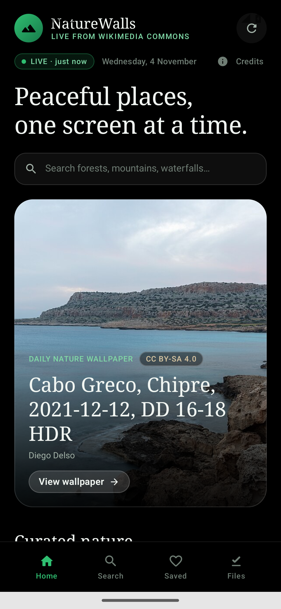
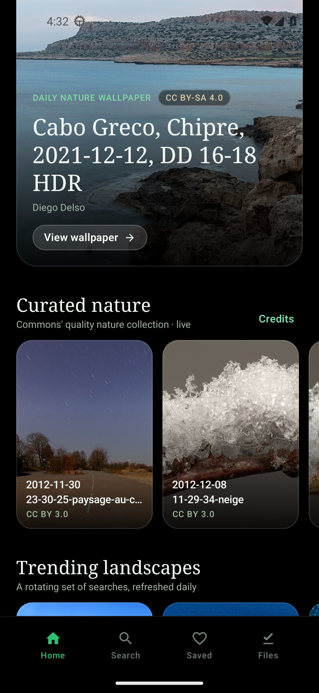
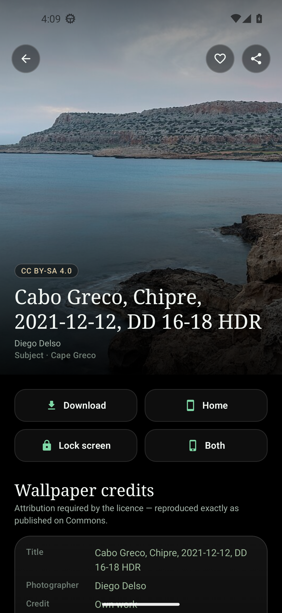
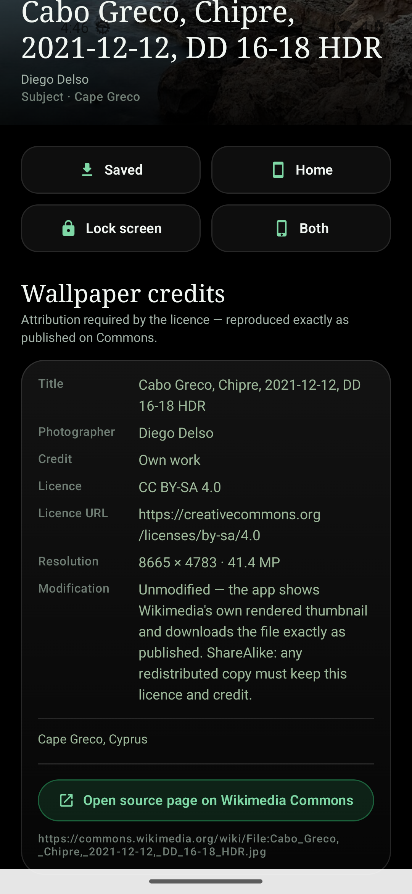
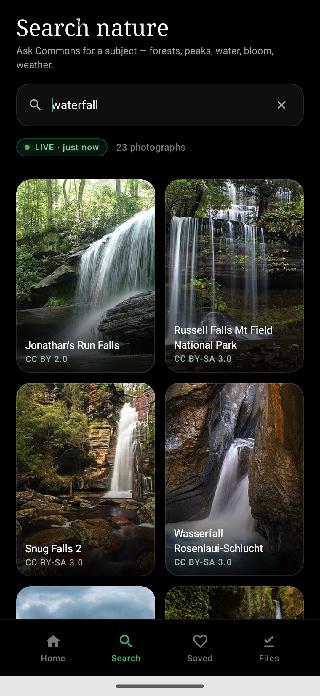
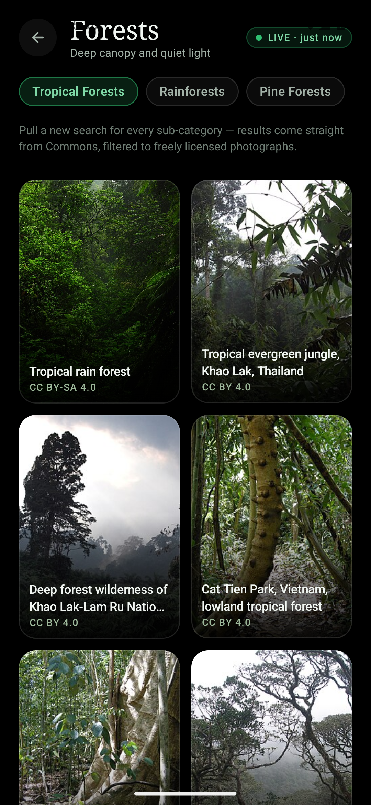
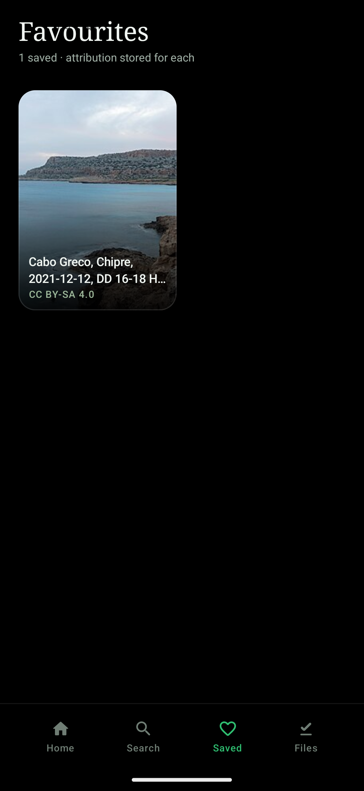
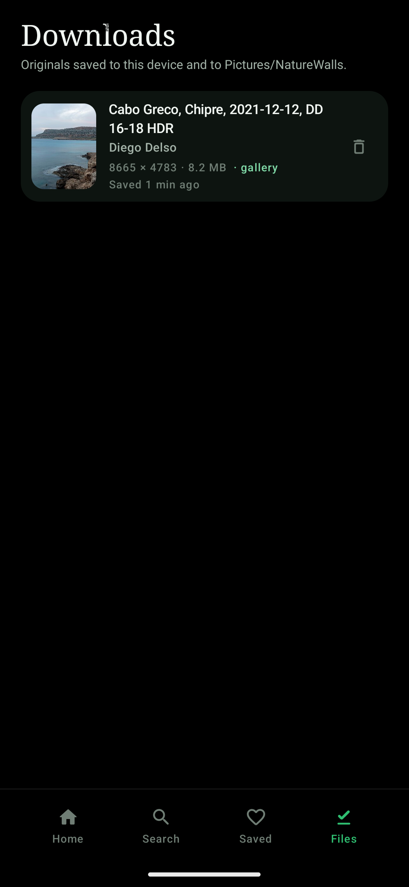
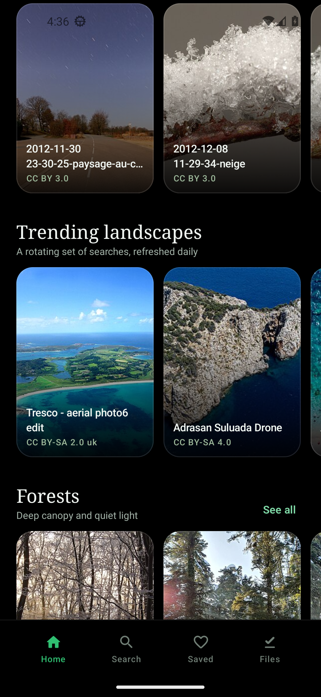

# NatureWalls — Premium Nature & Landscape Wallpapers

[](https://github.com/technicalnihilist-lgtm/naturewalls/actions/workflows/android.yml)
[](https://github.com/technicalnihilist-lgtm/naturewalls/releases/latest)
-0B3D24)


> **Install:** grab the signed APK from the [latest release](https://github.com/technicalnihilist-lgtm/naturewalls/releases/latest)
> (`NatureWalls-1.0.0.apk`, ~20 MB, Android 8.0+). Screenshots below are real captures from an
> Android 13 emulator, taken by this repo's CI workflow.

A complete Android application (Kotlin · Jetpack Compose · Material 3) that streams real nature
photography from the official **Wikimedia Commons API**, verifies each file's licence and
attribution metadata, and sets any of it as your home screen, lock screen or both.

Everything is **live**. There is no bundled image list, no seed data and no offline catalogue: each
screen issues its own Commons API call when you open it, and every card carries a `LIVE · 2 min ago`
badge with the time of the last successful fetch.

## Screenshots

Real device captures (Pixel 5, Android 13, live content from Wikimedia Commons), refreshed by
`.github/workflows/android.yml` on every push.

| Home — live feed | Collections | Wallpaper detail |
|---|---|---|
|  |  |  |

| Credits on the wallpaper | Search | Category browsing |
|---|---|---|
|  |  |  |

| Favourites | Downloads | Credits ledger |
|---|---|---|
|  |  |  |

---

## 1. What the app does

**Home** — logo, search entry, daily nature wallpaper hero, curated shelf, trending landscapes,
the six collection shelves (Forests, Mountains, Waterfalls & Rivers, Flowers & Plants, Natural
Landscapes, Weather & Seasons), recently added, recently viewed, and a live-source footer.

**Browse** — each collection opens a two-column print-wall grid with its sub-categories as chips
(e.g. Misty Forests, Himalayan Mountains, Cherry Blossoms, Foggy Landscapes). Switching a chip
issues a new Commons search; scrolling to the bottom follows the API `continue` cursor.

**Search** — free-text nature subjects with suggested subjects, recent search history and
paginated results.

**Detail** — full-bleed preview, title, verified location (only when Commons publishes GPS or a
location value, otherwise the natural subject), download, set as home / lock / both, favourite,
share, resolution, photographer, licence name + licence URL, source page link, modification note,
and a plain-language summary of the licence terms.

**Favourites** — saved wallpapers with their credits stored alongside, persisted in Room.

**Downloads** — the original file saved to app storage *and* to `Pictures/NatureWalls`, listed with
size, resolution and save time, deletable.

**Credits** — the complete attribution ledger of every photograph this device has displayed,
each row opening its Wikimedia Commons source page.

---

## 2. Wikimedia integration (real, not mocked)

| Concern | Implementation |
|---|---|
| Endpoint | `https://commons.wikimedia.org/w/api.php` (`data/remote/WikimediaApi.kt`) |
| Discovery | `generator=search` with `gsrsearch="<subject> filetype:bitmap"`, `gsrnamespace=6` |
| Collections | `generator=categorymembers` on `Category:Quality images of nature`, optionally `gcmsort=timestamp&gcmdir=desc` for *Recently added* |
| Metadata | `prop=imageinfo`, `iiprop=url|size|extmetadata|timestamp|mime`, `iiurlwidth=1600` |
| Attribution | `extmetadata`: `Artist`, `Credit`, `LicenseShortName`, `LicenseUrl`, `ImageDescription`, `UsageTerms`, `Categories`, `GPSLatitude/GPSLongitude`, `DateTime` |
| Pagination | the response `continue` map is replayed as query parameters (opaque cursor string) |
| User-Agent | descriptive UA on every request, as Wikimedia's policy requires |
| Resilience | OkHttp retry interceptor (429/5xx, exponential backoff), 48 MB HTTP cache, `maxlag=5`, per-shelf error states with retry |
| Thumbnails | 1600 px preview from the API, 600 px grid thumbnail derived by rewriting the `/NNNpx-` segment — one call, two sizes |

No scraping, no HTML parsing, no bundled fixtures, no fabricated records.

### Licence gate

`data/remote/LicensePolicy.kt` + `WallpaperMapper.kt` admit a file only when **all** of these hold:

* licence is **CC0**, **Public Domain**, **CC BY** or **CC BY-SA**
* licence is not NonCommercial, not NoDerivatives, not "fair use"/"all rights reserved"/unknown
* original is at least **1200 px** wide, and is JPEG or PNG
* when attribution is required (CC BY / CC BY-SA), a creator is actually published
* Commons categories do not mark it as a painting, print, diagram, map, bird, animal portrait,
  building, vehicle, logo or document

Anything that fails is dropped, and the repository keeps requesting the next page until it has
enough survivors to fill the shelf, so a strict filter never leaves a half-empty screen.

---

## 3. Architecture

```
app/src/main/java/com/naturewalls/app/
├─ NatureWallsApp.kt          Application + Coil ImageLoader (25% memory / 256 MB disk cache)
├─ MainActivity.kt            edge-to-edge Compose host
├─ di/AppContainer.kt         manual DI (Retrofit, Room, repositories, utils)
├─ data/
│  ├─ model/                  Wallpaper, DownloadedWallpaper, CategoryCatalog (live search terms)
│  ├─ remote/                 Retrofit API, DTOs (formatversion=2), client, licence policy, mapper
│  ├─ local/                  Room: wallpapers, favorites, downloads, recent_views, search_history, daily_picks
│  ├─ prefs/                  DataStore (last live fetch time, daily pick)
│  └─ repository/             WallpaperRepository (live), LibraryRepository (favourites/downloads)
├─ util/                      ImageDownloader, WallpaperSetter, ShareHelper, HtmlText, TimeFormat
├─ work/DailyWallpaperWorker  WorkManager periodic refresh of the daily pick
└─ ui/
   ├─ theme/                  AMOLED palette, serif+sans typography, shapes
   ├─ components/             GlassPanel, cards, rails, chips, shimmer, state panels
   ├─ home/ browse/ search/ detail/ favorites/ credits/ navigation/
   └─ AppViewModelProvider.kt one factory for all ViewModels
```

* **UI** — Jetpack Compose, Material 3, single-activity Navigation-Compose graph, AMOLED `#000000`
  canvas, forest-green `#2FBF71` accent, glassmorphism panels (white 7% → 2% wash + hairline),
  serif display type, no heavy gradients.
* **Networking** — Retrofit + Gson + OkHttp with retry and caching.
* **Images** — Coil with crossfade, memory/disk caches, thumbnails in grids and 1600 px previews on
  detail.
* **Persistence** — Room for favourites, downloads, recent views, search history, daily pick and
  the metadata cache used by the credits ledger. DataStore for tiny preferences.
* **Wallpaper** — `WallpaperManager.setBitmap(..., FLAG_SYSTEM | FLAG_LOCK)` with
  `isWallpaperSupported` / `isSetWallpaperAllowed` checks and a downsample-to-screen decode, so a
  6000 px original never blows the heap.
* **Downloads** — streamed to disk with progress, published to `MediaStore` (`Pictures/NatureWalls`)
  on Android 10+, legacy path below that.
* **Sharing** — `FileProvider` + `ACTION_SEND`, always with the full attribution block.

### Performance notes
Lazy grids and rails (no nested vertical scrolling), Coil size-aware requests, `inSampleSize`
decoding for wallpaper setting, background IO on `Dispatchers.IO`, in-memory dedupe so the same
image never repeats inside one feed, and a metadata cache pruned to 30 days while favourites and
downloads are kept forever.

---

## 4. Build

Requirements: Android Studio Ladybug+ (or JDK 17 + Android SDK 35), Gradle 8.9 (wrapper pinned).

```bash
# Android Studio: File ▸ Open ▸ <this folder>, then Run.
# Command line:
echo "sdk.dir=/path/to/Android/Sdk" > local.properties
./gradlew assembleDebug      # debug APK (debug key, applicationId com.naturewalls.app.debug)
./gradlew assembleRelease    # R8 + resource shrinking (add your signing config)
```

* `compileSdk 35`, `minSdk 26`, `targetSdk 35`, Kotlin 2.0.21, AGP 8.7.3, Compose BOM 2024.12.01.
* Permissions: `INTERNET`, `ACCESS_NETWORK_STATE`, `SET_WALLPAPER`, and legacy
  `WRITE_EXTERNAL_STORAGE` (maxSdk 28) only.
* Change the contact address in `WikimediaClient.USER_AGENT` to your own before publishing —
  Wikimedia expects a real contact in the User-Agent.

---

## 5. Verification performed

* **Built and shipped by CI** (`.github/workflows/android.yml`): every push produces a signed,
  R8-minified release APK, installs it on an Android 13 emulator, drives the real UI to capture
  nine screenshots, commits them to `docs/screenshots/` and attaches everything to the
  [v1.0.0 release](https://github.com/technicalnihilist-lgtm/naturewalls/releases/latest).
* **Two real bugs were caught by that emulator run and fixed**, which is exactly why it runs:
  * *Blank photographs.* Commons' thumbnail service only renders a fixed set of widths
    (500 / 1280 / 1920 px) and answers **HTTP 400** for anything else. The app was rewriting the
    preview URL to a 600 px thumbnail, so every grid card failed to load. It now takes the API's
    own 500 px thumbnail and derives the 1280 px preview bucket; small originals keep their
    original URL instead of being upscaled.
  * *Blocked image requests.* `upload`/`thumb.wikimedia.org` return **403** to a bare
    `okhttp/x.y.z` User-Agent. Coil now sends NatureWalls' descriptive UA through its call factory.
  * Hardware bitmaps were also disabled (`allowHardware(false)`), because they decode but never
    composite on software-GPU devices and cannot be handed to `WallpaperManager`.
* **Download pipeline proven on-device**: the screenshots show the original *Cabo Greco* file
  (8665 × 4783, 8.2 MB) saved to `Pictures/NatureWalls` and listed with its photographer.
* **Live API contract tested against commons.wikimedia.org**: `formatversion=2` returns
  `query.pages` as an array; `extmetadata` carries `LicenseShortName`, `Artist`, `Categories`,
  `ImageDescription`, `LicenseUrl`; the `continue` block returns `gsroffset` for pagination.
* **Catalogue validated**: all 48 sub-category searches were run against the live API; each
  returned dozens of photographs passing the licence filter (`waterfall` 20/25,
  `sunflower field` 25/25, `himalaya mountains` 23/25). Queries that came back thin were retuned
  before shipping.
* **Filter behaviour measured**: `Quality images of nature` passes 42/50 pages and therefore drives
  the curated shelves; `Featured pictures of nature` passes only 5/15 (it is dominated by bird and
  animal features), so it is deliberately not used.

---

## 6. Attribution policy (short version)

Photographs remain the property of their photographers. NatureWalls redistributes them unmodified
under the licence published on Commons and shows the credit block everywhere: on the detail screen,
in the credits ledger, and inside every share. CC BY-SA copies you pass on must keep the same
licence and credit. Metadata comes from Wikimedia Commons (CC BY-SA 4.0). This app is independent
and not affiliated with the Wikimedia Foundation.
